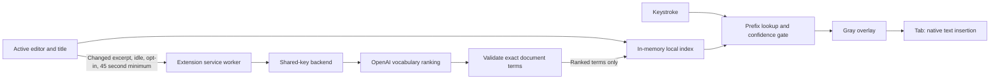

# Architecture

## The insight

William Chenyin identified that next-word prediction has two different time scales. A model can understand a document periodically; the browser must react to typing immediately. Moving vocabulary ranking out of the interaction path avoids waiting for a remote inference request after every character.

## Local prediction

The engine tokenizes a bounded document window, counts words, weights title terms, and builds a prefix lookup map and one-to-three-token continuation tables. Each keystroke looks up matching document words, boosts matches supported by the preceding tokens, and compares the best candidate against competing candidates.

The confidence score combines dominance, prefix length and contextual evidence. An isolated one-letter match needs strong support. No prediction is made after punctuation or whitespace alone. Multiword continuation requires repeated, dominant evidence at every step and stops as soon as the confidence drops below the chosen threshold. There is an internal eight-token safety ceiling, but the user's control is evidence confidence, not a fixed output length.

Cloud ranking only adds a modest weight to vocabulary already in the local index. It does not create a new word or trust model-reported confidence. The server validates every ranked term as a bounded, whole-token substring of the excerpt or title, then the engine independently filters it against its own vocabulary.

## Editor integration

The content script listens for focus, input, selection, composition, scroll and resize events. Editor adapters read a selection snapshot and locate the caret. A shadow-root overlay renders gray text without inserting speculative text into the user's document. Tab verifies that the selection still matches the snapshot before insertion. Native editing is preferred to preserve undo and integration with supported editors.

Selections, IME composition, stale snapshots, unsupported layout, paused sites, and loss of focus suppress suggestions. Editor switches increment a generation counter, which rejects late cloud responses from the previous document. Disabling cloud clears ranking weights and cancels pending service-worker fetches.

## Server boundary

The extension service worker owns networking. API URLs are public configuration, not secrets. The server holds the shared API key, requests schema-constrained output with `store: false`, and never returns provider credentials. Document excerpts and ranking outputs are not written to disk or logs.

SQLite stores quota reservations only. An immediate transaction reserves daily, monthly and per-IP hourly allowances before each provider call. Provider failures do not refund allowances, preventing retries from bypassing a budget. The server bounds bodies, excerpts, model output, concurrent calls and response time.

One persistent SQLite volume and one application instance are the supported deployment topology. Horizontal scaling needs a shared transactional quota store. CORS allowlists reduce accidental access but cannot authenticate a public client. An anonymous endpoint cannot prevent all abuse or distinguish every person behind a shared network.

## What the benchmark means

`npm run benchmark` reports local engine lookup p50/p95/p99 for 10,000 calls on a 28,800-character fixture. It also reports indexing separately. It does not measure input-to-screen latency, a cloud round trip, real-world suggestion accuracy, memory retention, or speedup over human typing. Those need user studies and browser instrumentation.

## Next steps

Calibrate the heuristic gate on consented evaluation data, measure end-to-end input-to-paint latency across editors, add framework-specific adapters, test accessibility with screen readers, and separately validate Google Docs support before advertising it. Users remain responsible for accepting suggestions and the content of their writing.
