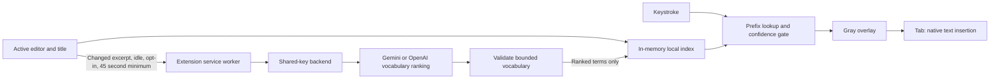

# Architecture

## The insight

William Chenyin identified that next-word prediction has two different time scales. A model can understand a document periodically; the browser must react to typing immediately. Moving vocabulary ranking out of the interaction path avoids waiting for a remote inference request after every character.

## Local prediction

The engine starts with 107 hand-curated everyday words, then tokenizes a bounded document window, counts words (including function words), weights title terms, and builds a prefix lookup map and one-to-three-token continuation tables. Common-word weights are heuristic priors, not calibrated frequencies. This dictionary works offline and survives clearing AI ranks. Each keystroke looks up matching document words, boosts matches supported by the preceding tokens, and compares the best candidate against competing candidates.

The confidence score combines dominance, prefix length and contextual evidence. An isolated one-letter match needs strong support. No prediction is made after punctuation or whitespace alone. Multiword continuation requires repeated, dominant evidence at every step and stops as soon as the confidence drops below the chosen threshold. There is an internal eight-token safety ceiling, but the user's control is evidence confidence, not a fixed output length.

Cloud ranking boosts existing vocabulary and adds closely related terms that have not appeared yet. The prompt prioritizes sentence connective wording, not a subject glossary. Its structured response first states the document requirements, then requests 50 sentence-building phrases and 30 close document terms. The 107 built-in standalone words are excluded from both the prompt output and the server filter; phrases containing them remain eligible. Titles and headings identify the immediate writing task. The server flattens these groups and removes duplicates. The public-cache generator rejects reviewed incomplete fragments and requests fresh AI entries to fill gaps, up to three supplemental attempts. It records supplemental prompts alongside the cache. The server checks term length, character format, duplicates and a five-word limit. This validates format, not factual relevance. New words have weaker evidence than document words and require at least two typed characters (three at conservative confidence settings). Inferred phrases require an unambiguous phrase and a threshold of 0.80 or lower; observed document context takes precedence over inferred phrase extensions. The confidence score remains a heuristic, not a calibrated probability. Clearing ranks or changing documents removes inferred terms.

## Editor integration

The content script listens for focus, input, selection, composition, scroll and resize events. Editor adapters read a selection snapshot and locate the caret. A shadow-root overlay renders gray text without inserting speculative text into the user's document. Tab verifies that the selection still matches the snapshot before insertion. Native editing is preferred to preserve undo and integration with supported editors.

Selections, IME composition, stale snapshots, unsupported layout, paused sites, and loss of focus suppress suggestions. Editor switches increment a generation counter, which rejects late cloud responses from the previous document. Disabling cloud clears ranking weights and cancels pending service-worker fetches.

## Server boundary

The extension service worker owns networking. API URLs are public configuration, not secrets. The server holds the shared API key, requests schema-constrained output (OpenAI requests use `store: false`), and never returns provider credentials. Live document excerpts and ranking outputs are not written to disk or logs. The public demo is an exception for authored, public sample drafts: its vocabulary JSON stores real Gemini responses and the exact prompt, generated with `npm run demo:vocabulary`. It contains no private drafts or credentials.

SQLite stores quota reservations only. An immediate transaction reserves daily, monthly and per-IP hourly allowances before each provider call. Provider failures do not refund allowances, preventing retries from bypassing a budget. The server bounds bodies, excerpts, model output, concurrent calls and response time.

One persistent SQLite volume and one application instance are the supported deployment topology. Horizontal scaling needs a shared transactional quota store. CORS allowlists reduce accidental access but cannot authenticate a public client. An anonymous endpoint cannot prevent all abuse or distinguish every person behind a shared network.

## What the benchmark means

`npm run benchmark` reports local engine lookup p50/p95/p99 for 10,000 calls on a 28,800-character fixture. It also reports indexing separately. It does not measure input-to-screen latency, a cloud round trip, real-world suggestion accuracy, memory retention, or speedup over human typing. Those need user studies and browser instrumentation.

## Next steps

Calibrate the heuristic gate on consented evaluation data, measure end-to-end input-to-paint latency across editors, add framework-specific adapters, test accessibility with screen readers, and separately validate Google Docs support before advertising it. Users remain responsible for accepting suggestions and the content of their writing.

## Ranking refresh policy

After editor focus or input, wait for 1.8 seconds without another input event. Only rank documents of at least 80 characters, and skip unchanged excerpts. The content script enforces a 45-second cooldown and the service worker enforces the same limit per tab/frame, with one in-flight call at a time. This is a configurable-in-code cost/freshness tradeoff, not an empirically optimized interval; continuously typing postpones ranking until a pause. A pause during the cooldown does not queue a future refresh: another input/focus event must trigger a later attempt.

Each attempt sends the same instruction and a fresh title/document excerpt, not a conversation history or the prior cache. Useful document words may recur between refreshes; a successful nonempty response replaces the old AI ranks rather than accumulating them. Failure or throttling preserves the last cache. Changing the active editor or opting out clears it. Ranking has a 30-second server deadline and a 32-second extension deadline; local completion never waits on this call.

Public demo cache generation may use up to three supplemental calls to replace duplicates or rejected entries. Normal extension refreshes make one provider call and keep up to 80 valid entries, without supplemental retries. The published main prompt is available at `public/autocomplete-prompt.txt`; public cache metadata records any supplemental prompts.
